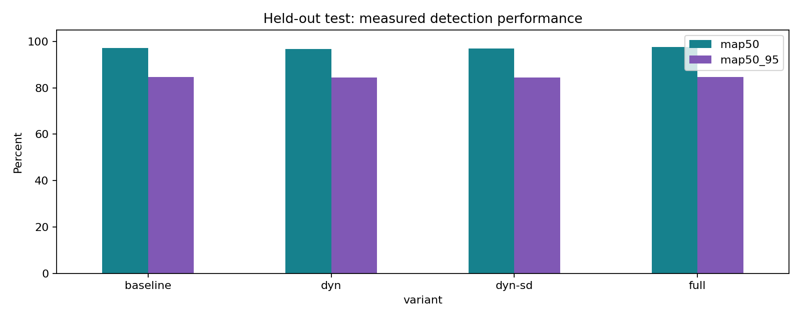
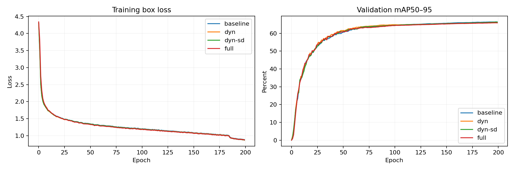
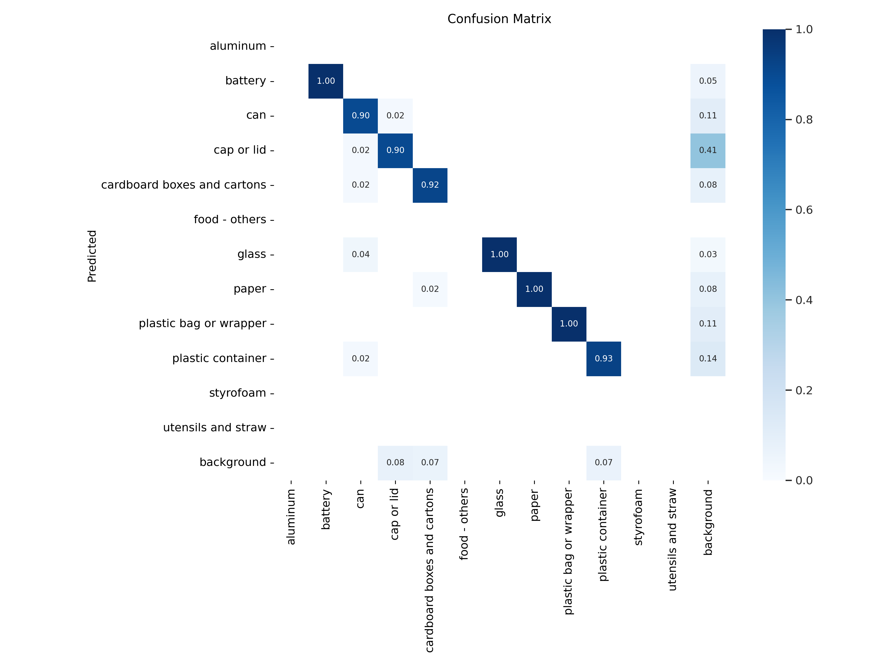
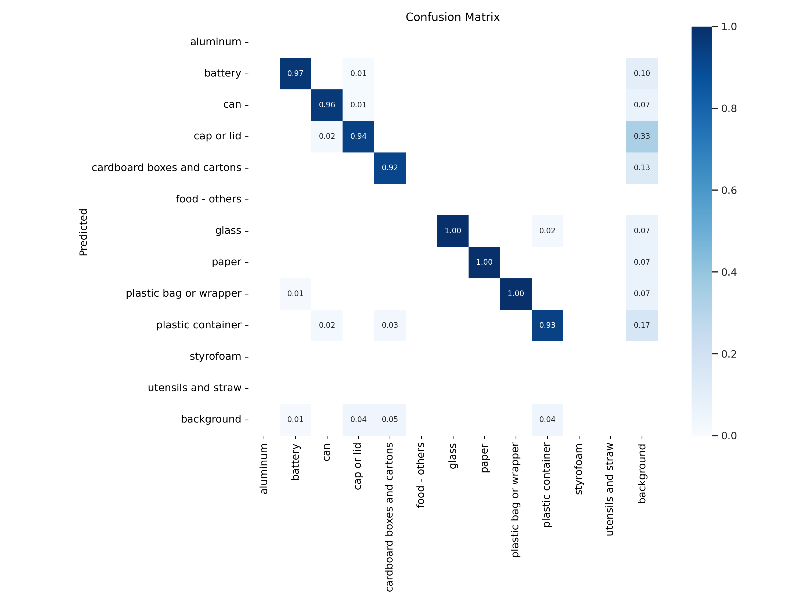
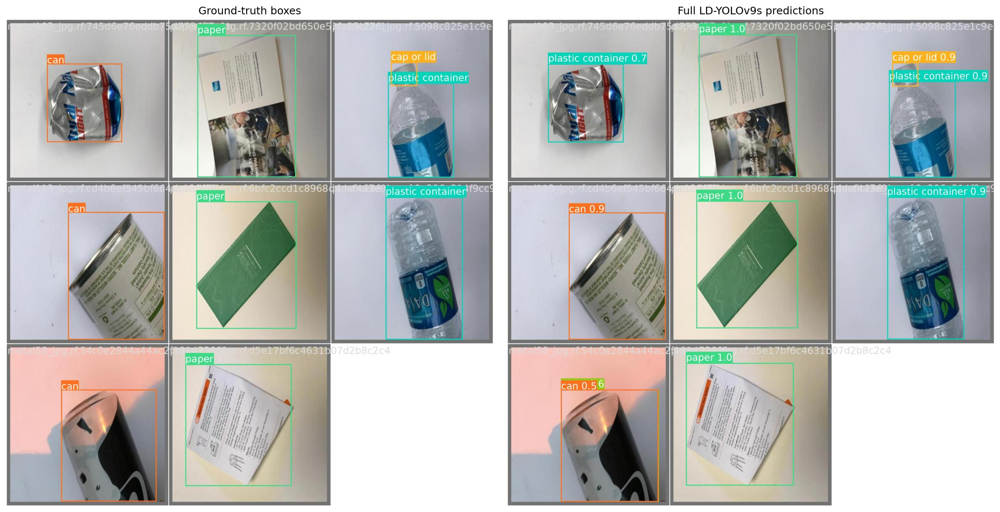
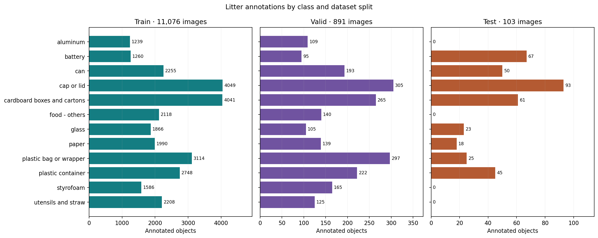

# LD-YOLOv9s — Surface Litter Detection

Reconstructed research implementation of YOLOv9s with dynamic convolution,
space-to-depth downsampling and MPDIoU. Includes a controlled cumulative
ablation study, portable configs and evaluation/report scripts.


Paper: [Deep learning-based image processing framework for efficient surface
litter detection in Computer Vision applications](https://doi.org/10.1016/j.jrras.2025.101534).

| Config | Dynamic conv | SDConv-ADown | Box loss |
|---|---|---|---|
| baseline | No | No | CIoU |
| dyn | Yes | No | CIoU |
| dyn-sd | Yes | Yes | CIoU |
| full | Yes | Yes | MPDIoU |
| sd-only (optional) | No | Yes | CIoU |
| mpdiou-only (optional) | No | No | MPDIoU |


## Train and evaluate

Choose an available physical GPU, for example 4. Training is from scratch.

```bash
source env.sh
TRAIN_LOG="logs/train-$(date +%Y%m%d-%H%M%S).log"
nohup .venv/bin/python -u run_project.py train --gpu 4 > "$TRAIN_LOG" 2>&1 < /dev/null &
echo "Queue PID: $!  Log: $TRAIN_LOG"
```

The log prints the study directory. Default runs baseline, dyn, dyn-sd, full.
Use `--variants baseline dyn dyn-sd full sd-only mpdiou-only` to predeclare all six.
To reuse confirmed completed runs, pass the same `--run runs/study-TIMESTAMP`.
After training, use the actual directory in place of the placeholder:

```bash
nohup .venv/bin/python -u run_project.py evaluate --gpu 4 --run runs/study-TIMESTAMP > logs/evaluate.log 2>&1 < /dev/null &
```

Evaluation produces measured JSON/CSV, PR/F1 curves and confusion matrices.
Reports are written directly to `results/`. No dummy metrics are included.
Publish with `.venv/bin/python report_results.py --export`; the separate export
contains source and aggregate result figures, not the dataset or environment.

## Validation

`.venv/bin/python check_project.py` tests six model variants, backward loss,
pixel-coordinate MPDIoU scaling, dynamic kernel batch independence, downsample
shapes and checkpoint serialization. These are synthetic implementation checks.
Actual GPU training quality is determined only by completed experiments.

## License

Based on [WongKinYiu/YOLOv9](https://github.com/WongKinYiu/yolov9), pinned commit
`5b1ea9a8b3f0ffe4fe0e203ec6232d788bb3fcff`. See [GPL license](LICENSE.md).

<!-- measured-results -->
## Measured results





### baseline test confusion matrix



### full test confusion matrix



<!-- ld-test-gallery -->
## Test results

Evaluation on 103 held-out images. All values are percentages.

| Model | Precision | Recall | mAP50 | mAP50–95 |
|---|---:|---:|---:|---:|
| baseline | 95.58 | 95.15 | 97.09 | 84.72 |
| dyn | 95.08 | 93.68 | 96.83 | 84.46 |
| dyn-sd | 94.56 | 95.46 | 97.04 | 84.50 |
| full | 96.19 | 95.78 | 97.51 | 84.62 |

### Qualitative test examples

Each pair shows the same test images with annotated boxes on the left and predictions on the right. Examples follow test-loader order.



[View test batch 2](results/qualitative-test-2.jpg)

[View test batch 3](results/qualitative-test-3.jpg)

### Dataset distribution

Bars count annotated objects. Each panel uses its own horizontal scale.



[Full model precision–recall curve](results/full-PR_curve.png)

[F1 across confidence thresholds](results/full-F1_curve.png)

[Full model training and validation history](results/full-results.png)

[Training labels and bounding-box distribution](results/full-labels.jpg)

[Bounding-box coordinate correlations](results/full-labels_correlogram.jpg)
